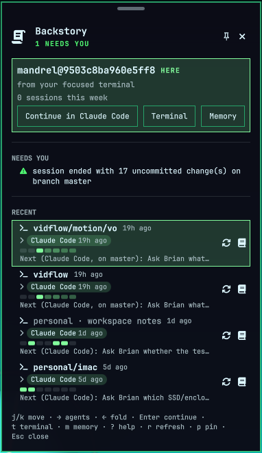

# Backstory — Omarchy panel

Memory for your AI coding agents. The panel shows each project's latest handoff,
what needs your attention, and a one-click **Continue** that resumes the work in
your agent. It also adds a bar widget showing the project you are in.

**Every agent starts where you left off.**



This repo is the shell plugin only. The memory itself comes from the
[`backstory`](https://github.com/RidgetopAi/backstory) daemon. The plugin is a
client: it runs the `backstory` CLI and reads its output, and it never opens the
store directly.

## Install

```sh
yay -S backstory                          # the daemon + CLI (AUR)
systemctl --user enable --now backstory   # start the memory daemon
backstory install                         # hook up the agents it detects (claude, codex, hermes, pi)
backstory backfill claude                 # optional: import your existing Claude Code history
omarchy plugin add https://github.com/RidgetopAi/backstory-panel --enable
```

Optional: the package ships a Hyprland snippet at
`/usr/share/backstory/hyprland/backstory.lua`. It sizes and places the panel window
and binds **Ctrl+Shift+B** to open it. Copy it to `~/.config/hypr/backstory.lua` and
add `require("hypr.backstory")` to your `hyprland.lua`.

## What it runs

Every command the plugin can run is listed in `js/launchers.js`:

- `backstory this-week`, `records`, `tools`: reads the memory, all with `--json`.
- `backstory affirm`, `done`, `delete`, `purge`: only when you press the matching
  button. Edit opens `backstory edit` in a terminal through `xdg-terminal-exec`.
- `omarchy agent prompt`, `omarchy agent --pick`, `omarchy-default-agent`: used by
  Continue / Resume to start your agent.
- `xdg-terminal-exec -- sh -c …`: opens a terminal in the project's directory. The
  path is passed as an argument and is never inserted into the shell script.
- `hyprctl dispatch focuswindow`, `tmux select-window` / `select-pane`: brings an
  already-running agent to the front instead of starting a new one.
- `omarchy-shell`: toggles and focuses the panel itself.

The plugin makes no network calls. The daemon makes none either, unless you set up
the optional ssh sync between your own machines (`backstory install sync`).

## Remove

```sh
omarchy plugin remove ridgetopai.backstory
backstory install --remove                # unhook the agents
systemctl --user disable --now backstory
yay -R backstory
```

Your memory stays in `~/.local/share/backstory` until you delete it.

## License

MIT. This repo is the `panel/` directory of
[RidgetopAi/backstory](https://github.com/RidgetopAi/backstory) at the release named
in `manifest.json`. Report issues there.
